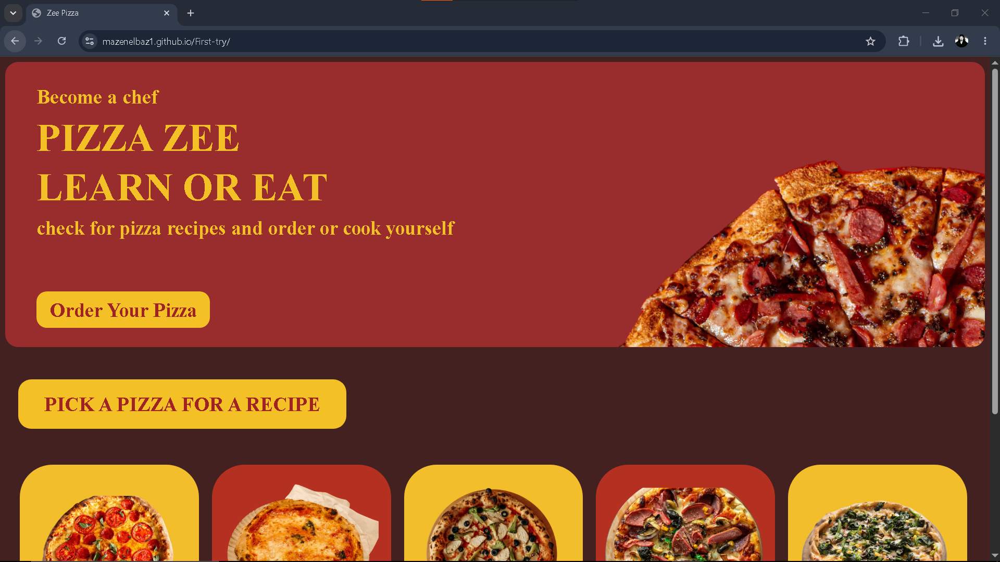

# Pizza Zee

## Overview
A simple pizza web

## Description

It's a Simple Pizza Website that lets you select between 5 different types of pizza, which are pepperoni, margherita, chicken, supreme, veggie pizza. it also provides a recipe of each one so you can make your own.

## Live Demo

[Open The Web ](https://mazenelbaz1.github.io/First-try/)

## Screenshots

The image above is a screenshot of the working website

## Languages Used

* HTML
* CSS
* JavaScript

## Getting Started

### Dependencies

* A modern web browser (Goofle Chrome, Edge)
* Windows 10 / Windows 11

### Installing

1. Download or clone the repository.
2. Open project folder.
3. Find and open index.html to run it.
4. No additional packages or installation are required.

## Credits

Used photos from Pexels
Made by mazenelbaz01

## License

This project is licensed under the [MIT License](LICENSE)
